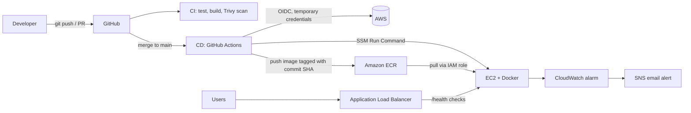

# DevOps Project: Containerized App on AWS with CI/CD

An end-to-end deployment pipeline for a small Flask API. A merge to `main` builds a Docker image, pushes it to Amazon ECR, and deploys it to an EC2 instance behind an Application Load Balancer, with no AWS keys stored in GitHub and no SSH port opened to the internet.

## Architecture



## Tech stack

| Area | Tools |
|---|---|
| App | Python, Flask, Gunicorn, pytest |
| Containers | Docker (multi-stage, non-root), Docker Compose |
| Cloud | AWS: ECR, EC2, IAM, ALB, SSM, CloudWatch, SNS |
| Configuration management | Ansible (roles: `common`, `docker`, `app`) |
| CI/CD | GitHub Actions, GitHub OIDC, Trivy |

## Repository layout

```
.
├── app/                    Flask API, tests, Dockerfile
├── docker-compose.yaml     Local development
├── ansible/                Inventory, playbook and roles to configure the server
│   ├── playbooks/deploy.yml
│   └── roles/{common,docker,app}
└── .github/workflows/
    ├── ci.yml              Test, build and scan on pull requests and pushes
    └── cd.yml              Build, push to ECR, deploy via SSM on merge to main
```

## How it works

1. **Application.** `/` returns the running version (the Git commit SHA once deployed) and `/health` returns `{"status":"ok"}`.
2. **Docker.** A multi-stage Dockerfile installs dependencies in a builder stage and copies only what is needed into a slim runtime image. It runs as a non-root user, defines a `HEALTHCHECK`, and serves with Gunicorn.
3. **CI** (`ci.yml`). On every pull request and push to `main`: install dependencies, run pytest, build the image, and scan it with Trivy.
4. **CD** (`cd.yml`). On merge to `main`:
   - GitHub authenticates to AWS using **OIDC**. The IAM role can only be assumed by this repository's `main` branch, so there are no long-lived keys.
   - The image is built and pushed to ECR, tagged with the commit SHA for traceability and easy rollback.
   - The deploy runs through **AWS Systems Manager Run Command**, so the instance needs no inbound SSH from GitHub.
   - A final step calls `/health` to confirm the new container is serving.
5. **Ansible.** Configures a fresh server: base packages, Docker installed and enabled, ECR login, and the app container started. Tasks are idempotent, so a second run reports `ok` rather than `changed`.
6. **Load balancing and monitoring.** An ALB forwards traffic to a target group that health-checks `/health`. A CloudWatch alarm sends an SNS email when average CPU stays above 70% for 10 minutes.

## Run locally

```bash
docker compose up --build
curl localhost:5000/health
```

Run the tests:

```bash
cd app
pip install -r requirements.txt
python -m pytest
```

## Security decisions

- IAM roles instead of stored credentials: EC2 pulls from ECR through an instance profile; GitHub uses OIDC.
- The GitHub role is scoped to one repository, one branch, one ECR repository, and `SendCommand` for shell scripts.
- SSH is limited to a single admin IP, and the pipeline does not use SSH at all.
- Container runs as a non-root user; images are scanned on push (ECR) and in CI (Trivy).
- No secrets, `.pem` files or access keys are committed.

## Issues I hit and how I solved them

| Problem | Root cause | Fix |
|---|---|---|
| Docker build failed | Typo in the `requirements.txt` filename | Read the failing `RUN` line in the build log |
| Container restart loop | Gunicorn target written as `main.app` instead of `main:app` | Corrected the `CMD` |
| `SG_ID` was `None` | `--query` hid the real error and shell variables were lost between terminals | Reran without `--query`; re-exported variables |
| SSH timeout to a new instance | Connecting to a stale public IP | Looked up the current IP with the CLI |
| Ansible could not find roles | Roles live outside the playbook directory | Added `roles_path = roles` to `ansible.cfg` |
| `pip` broke the server's `aws` CLI | pip overwrote RPM-managed Python packages | Removed pip from the server role and used plain Docker commands |
| CI failed at job setup | Pinned Trivy action tag did not exist | Ran Trivy from its container image instead |

## Screenshots

Add these under `docs/` and link them here:

- Green CI and CD runs in the Actions tab
- ECR repository showing the commit-SHA tag
- ALB target group showing a healthy target
- The `/` response showing the deployed commit SHA
- The CloudWatch alarm

## Cost and cleanup

An ALB and a running EC2 instance are billed by the hour. When finished:

```bash
aws elbv2 delete-load-balancer --load-balancer-arn <alb-arn>
aws elbv2 delete-target-group --target-group-arn <target-group-arn>
aws ec2 terminate-instances --instance-ids <instance-id>
aws cloudwatch delete-alarms --alarm-names devops-high-cpu
```

## Next improvements

- Define all AWS resources with Terraform and keep state in S3
- Add a second instance and use Ansible `serial: 1` for rolling updates
- HTTPS with ACM and an HTTPS listener on the ALB
- Restrict the instance security group to traffic from the ALB only
- Move configuration values into SSM Parameter Store or Secrets Manager
- Auto Scaling Group across multiple Availability Zones
